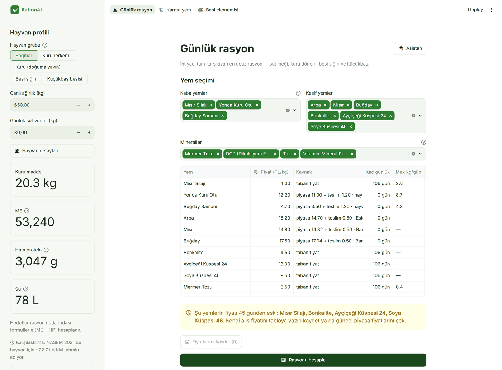
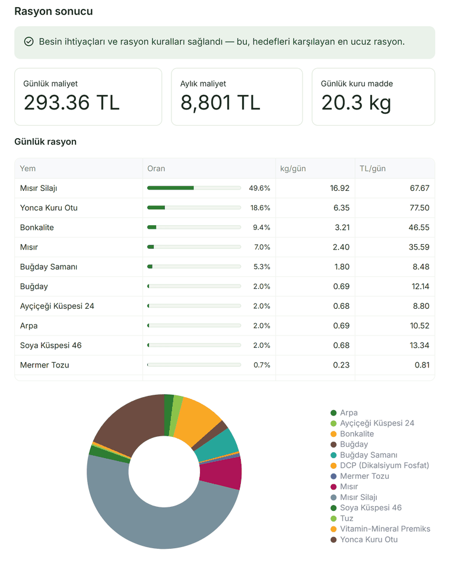
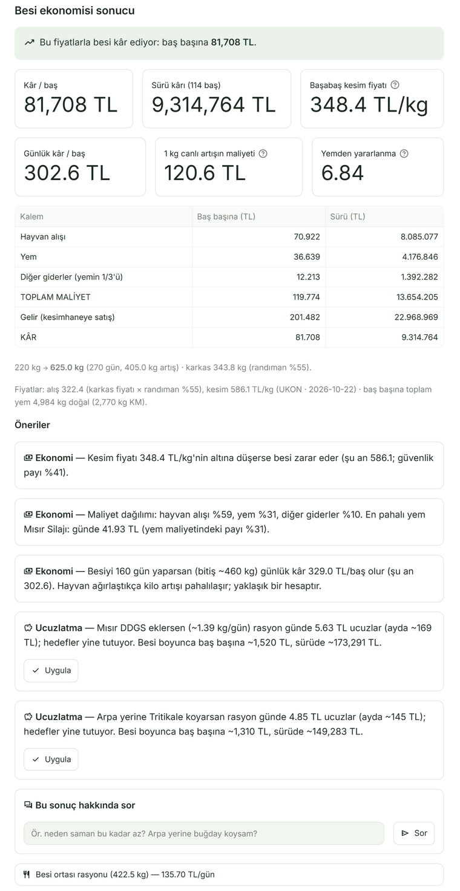
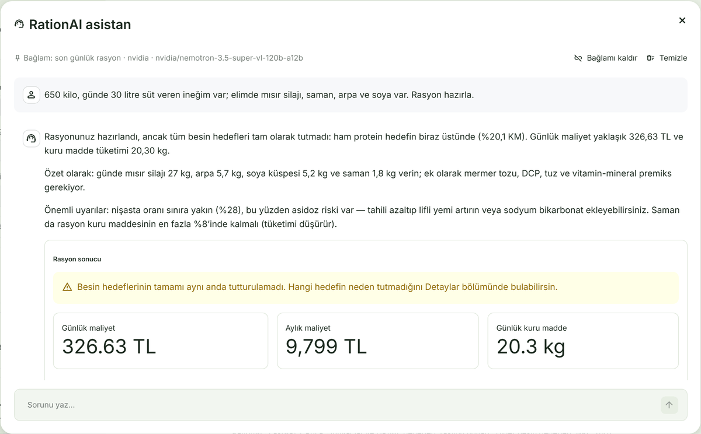
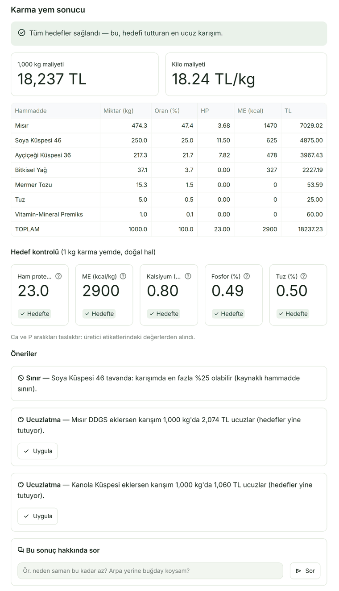

# RationAI 🐄

**Süt ineği, besi sığırı ve küçükbaş için en ucuz ama eksiksiz rasyonu saniyeler içinde
hesaplayan ücretsiz bir yardımcı.**

Elinizdeki yemleri seçin, hayvanınızı tanıtın; RationAI hayvanın ihtiyacını tam karşılayan,
sağlığını riske atmayan **en düşük maliyetli karışımı** kilogram kilogram çıkarsın. Karma yem
formülü hazırlar, bir besi döneminin kâr eder mi etmez mi olduğunu hesaplar ve sorularınızı
sohbetle cevaplar.



---

## Neden RationAI?

Yem, süt üretiminde giderin en büyük kalemi. Rasyonu göz kararı hazırlamak iki yoldan para kaybettirir:

- **Fazla verilen** protein ve enerji doğrudan cebinizden çıkar.
- **Eksik ya da dengesiz** rasyon süt verimini düşürür; asidoz, süt humması, kondisyon kaybı gibi
  sorunlar veteriner masrafı olarak geri döner.

RationAI bu dengeyi sizin yerinize kurar: ineğin ihtiyacını bir zooteknistin sahada kullandığı
**metabolik enerji (ME) ve ham protein (HP)** formülleriyle hesaplar — yaşama payı, süt verim
payı, gebelik payı, kalsiyum, fosfor ve su — sonra elinizdeki yemlerle bu ihtiyacı karşılayan
**en ucuz** kombinasyonu bulur. Yem değerleri Türkiye'de kullanılan yem tablosundan gelir.

## Kimler için?

- **Süt sığırı, besi ve küçükbaş yetiştiricileri** — kendi rasyonunu kendi hazırlamak isteyen çiftçiler
- **Zooteknistler ve besleme danışmanları** — sahada hızlı rasyon taslağı için
- **Yem bayileri ve kooperatifler** — müşterisine yem önerisi yapanlar
- **Ziraat / veteriner öğrencileri** — rasyon mantığını uygulamalı görmek için

## Nasıl çalışır? 3 adım

1. **Hayvanınızı tanıtın.** Grup (sağmal / kuru dönem / besi sığırı / küçükbaş), canlı ağırlık,
   günlük süt ya da hedef canlı ağırlık artışı. İsterseniz süt yağı, laktasyon günü ve gebelik
   gününü de girin — girmezseniz makul varsayılanlar kullanılır.
2. **Yemlerinizi seçin.** Silaj, kuru ot, saman, tahıl, küspe… 71 yemlik listeden elinizde
   olanları işaretleyin (en yaygınlar başta). Kendi alış fiyatınızı yazabilirsiniz.
3. **"Rasyonu hesapla"ya basın.** Her yemden günde kaç kilo vereceğinizi, günlük ve aylık maliyeti
   ve ineğin ihtiyacının karşılanıp karşılanmadığını görün.

## Örnek sonuç

650 kg, günde 30 litre süt veren bir inek; mısır silajı, yonca, saman, tahıllar, bonkalite ve
küspelerle (Ekim 2026 fiyatlarıyla). Rasyon günde **293 TL** tutuyor ve enerji (ME), ham protein,
kalsiyum, fosfor, lif (NDF), kaba yem oranı ve nişasta hedeflerinin **hepsini** karşılıyor.



## İneğinizin sağlığını nasıl korur?

RationAI "en ucuz"u ararken şu kurallardan asla taviz vermez:

- 🌾 **Asidoz koruması** — nişasta sağmalda kuru maddenin %28'ini geçmez, tahıl payı sınırlıdır.
- 🌿 **Geviş getirme için yeterli lif** — rasyonun en az %45'i kaba yemdir, NDF %28–35 aralığındadır.
- 🥛 **Kuru dönem ayrı beslenir** — yonca ve mermer tozu verilmez, doğuma yakın inekte günlük
  kalsiyum (≤ 100 g) ve fosfor (≤ 45 g) sınırlanır (süt humması), saman payı artırılabilir.
- ⚖️ **Mineral dengesi** — Ca:P oranı sağmalda 1.5–2.5, kuru dönemde en az 1; seçilen tuz en
  ucuz rasyonda bile düşürülmez.
- 🧪 **Yem kullanım sınırları** — arpa en fazla %40, buğday %10, ayçiçeği/soya küspesi %25,
  eklenen yağ %6, üre ve benzeri protein olmayan azot %1 (kuru maddede).
- 🚫 **Günlük azami miktarlar** — örneğin bir ineğe günde 25 kg'dan fazla silaj, 8 kg'dan fazla
  yonca kuru otu, 4 kg'dan fazla saman verilmez (canlı ağırlığa göre ölçeklenir). Bu sınırlar
  hiçbir durumda aşılmaz.
- 💬 **Dürüst uyarılar** — seçtiğiniz yemlerle ihtiyaç karşılanamıyorsa bunu açıkça söyler ve
  hangi yemi eklemeniz gerektiğini önerir. Enerji fazlasını da "günde ~X kcal fazla → ~Y kg
  kilo alır (7000 kcal ≈ 1 kg)" diye yazar.

## Besi sığırı

Hayvan grubunda **"Besi sığırı"**nı seçin: canlı ağırlık, hedef günlük canlı ağırlık artışı ve
besinin kaçıncı gününde olduğunuz yeterli. RationAI:

- Kuru madde tüketimini besi sığırı standardının (NASEM 2016) denklemiyle hesaplar: 200 kg
  danada canlı ağırlığın ~%3'ü, 600 kg'da ~%2,25'i. Enerji yaşama payı + artış payıdır; artış
  payı hayvan ağırlaştıkça artar (ağır danada kilonun çoğu yağdır, daha çok enerji ister).
- Proteini ve Ca/P'yi uluslararası besi sığırı standardından (NASEM/NRC 2016) alır.
- Besi başında kaba yemi %50'den 20 günde %30'a kademeli indirir (asidoza karşı alıştırma).
- 350 kg'dan sonra dane:küspe en az 6:1, besi rasyonunda soya küspesi yok.
- Sonuçta **"bu rasyonla beklenen artış ~X kg/gün"** yazar; hedef artış hayvanın yiyebileceği
  rasyonla mümkün değilse ulaşılabilir artışı söyler.

## Küçükbaş besisi

Hayvan grubunda **"Küçükbaş besisi"**ni seçin: canlı ağırlık, hedef günlük artış (gram) ve besi günü.

- Kuru madde, protein, kalsiyum ve fosfor ihtiyacını koyun standardından (NRC) ağırlığa göre
  alır: 20 kg kuzu canlı ağırlığının ~%5'ini, 50 kg toklu ~%3'ünü yer.
- Kesif yem kısmı en az **%16 ham protein** olur; kaba yem besi başında %50'den 20 günde %30'a iner.
- **Bakır zehirlenmesine karşı** sığır premiksi kullanılmaz, yerine bakırsız koyun premiksi gelir.
- **İdrar taşına karşı** Ca:P en az 2 tutulur ve amonyum klorür (%0,5) eklenir.
- Kuzuda üre ve benzeri protein olmayan azot, besi rasyonunda soya küspesi kullanılmaz.
- Sonuçta miktarlar gram ile, **"beklenen artış ~X g/gün"** ile birlikte gösterilir.

## Besi ekonomisi: bu besi kâr eder mi?

Üst menüden **"Besi ekonomisi"**ni seçin: tür (besi sığırı / küçükbaş), hayvan sayısı, besi başı
ağırlığı, günlük artış ve besi süresi. Elinizdeki yemleri işaretleyin.

- Yem maliyeti **besi ortasındaki ağırlığın** rasyonundan hesaplanır (en ucuz, ihtiyacı tam
  karşılayan rasyon × besi günü) — zootekni derslerindeki yöntem.
- Hayvan alışı, yem ve diğer giderler (yemin 1/3'ü ya da kalem kalem: ölüm/fire, veteriner,
  işçilik, faiz) toplanır.
- Satış, besicinin eti kesimhaneye sattığı gibi hesaplanır: bitiş ağırlığı × karkas randımanı ×
  kesim fiyatı. Randımanı (dana %55, küçükbaş %45) değiştirebilirsiniz.
- Baş başına ve sürü kârı, günlük kâr, 1 kg artışın maliyeti, yemden yararlanma ve **başabaş
  kesim fiyatı** (bunun altında besi zarar eder) gösterilir.
- Kesim (karkas) fiyatı **UKON**'un kombina ve kesimhanelerden topladığı haftalık fiyattır;
  Türkiye ortalaması ya da bölgeniz (Ege, Marmara, İç Anadolu…) seçilebilir. Uygulama bunu yem
  fiyatlarıyla birlikte **günde bir kez kendiliğinden günceller**.
- Hayvanın **alış fiyatını girmeniz gerekmez**: hayvan o günkü kesim fiyatından değerlenir
  (alış = kesim fiyatı × randıman). İsterseniz kendi alış fiyatınızı yazarsınız.



## Öneriler: ne yapmalısın?

Her sonucun altında bir **"Öneriler"** kutusu çıkar ve rasyonu nasıl düzelteceğinizi söyler:

- 🩺 **Sağlık** — "Tuz seçilmedi", "Nişasta sınıra yakın: asidoz riski", kuzuda "amonyum klorür
  seçilmedi: idrar taşı riski"…
- ⬆️ **Eksik** — "Protein ve enerji tutmuyor: Mısır DDGS ve yonca eklersen bütün hedefler
  tutuyor, maliyet +6,6 TL/gün."
- ⬇️ **Fazla** — "Enerji ihtiyacın günde ~8.300 kcal üstünde (≈1,2 kg/gün yağlanma): çayır otu ekle."
- ⛔ **Sınır** — "Buğday samanı günlük sağlık sınırında: bundan fazlası konmaz."
- 💰 **Ucuzlatma** — "Arpa yerine tritikale koyarsan rasyon günde 15 TL ucuzlar, hedefler yine tutuyor."

Öneriler tahmin değildir: program her öneriyi rasyona ekleyip **yeniden hesaplar** ve yalnızca
gerçekten işe yarayanları, gerçek miktar ve maliyetle gösterir. **"Uygula"** düğmesi önerilen
yemi seçime ekler ve rasyonu yeniden hesaplar. Karma yemde ve besi ekonomisinde de vardır;
besi ekonomisinde ayrıca başabaş kesim fiyatını, maliyet dağılımını ve daha kârlı bir besi
süresini söyler.

## Asistan: sor, hesaplasın

Her sayfanın sağ üstündeki **"Asistan"** düğmesi bir sohbet penceresi açar; RationAI'a yazarak
sorabilirsiniz:

- *"650 kilo, günde 30 litre süt veren ineğim var; elimde silaj, saman, arpa ve soya var. Rasyon hazırla."*
  — hesabı ekrandaki çözücüyle yapar, tabloyu ve önerileri sohbetin içinde gösterir.
- *"Peki soyayı çıkarıp ayçiçeği koysam?"* — önceki hesabı hatırlar, yeniden hesaplar.
- *"Kuru dönemdeki ineğe neden yonca verilmez?"* — rasyon notlarına ve programın kurallarına
  dayanarak cevaplar, kaynağını yazar.
- Karma yem (*"1 ton %21 süt yemi yap"*) ve besi kârı (*"114 danayı 270 gün beslesem ne
  kazanırım?"*) da sorulabilir.

Her sonucun altındaki **"Bu sonuç hakkında sor"** kutusuyla ekrandaki hesap hakkında soru
sorabilir, sohbetteki bir sonucu **"ekranında aç"** ile ilgili sayfaya taşıyabilirsiniz.
Rakamlar her zaman çözücüden gelir; yapay zekâ yalnızca anlatır. Model araç kullanmadan kendi
kafasından miktar yazarsa o cevap gösterilmez.



 Sohbet için `.env`'ye ücretsiz
bir NVIDIA (build.nvidia.com) ya da Groq anahtarı eklemek yeterli; anahtar olmadan da hesap
ekranlarının hepsi çalışır.

## Karma yem de hazırlar

Üst menüden **"Karma yem"**i seçin: yem tipini (süt yemi %21–23, buzağı başlangıç / büyütme,
düve–kuru dönem–besi başlangıç %14–16, besi yemi %12–13 ya da kendi hedefiniz) ve elinizdeki
hammaddeleri işaretleyin. RationAI 1 ton (veya istediğiniz miktar) için hedef ham protein ve
enerjiyi tutturan **en ucuz karışımı** defterdeki gibi çıkarır: her hammaddenin kilosu, HP ve
ME katkısı, ton maliyeti.

- Hammadde sınırları kaynaklıdır (Penn State, Feedipedia, NDDB): örneğin DDGS en fazla %25,
  buğday kepeği %20, pamuk küspesi %20; tek bir ucuz hammadde karışımı dolduramaz.
- Buzağı yemine pamuk küspesi, tam yağlı çiğit ve yer fıstığı küspesi girmez; besi yemine soya
  küspesi girmez ve dane:küspe en az 6:1 olur.
- Vitamin-mineral premiks tonda 1 kg sabit; tuz, mermer tozu ve DCP'yi Ca/P hedefi belirler.



## Güncel yem fiyatları

Fiyatlar, **orta-büyük bir süt işletmesinin yemi çiftliğe teslim alırken ödediği ortalama
fiyat** olarak hesaplanır — tek bir satıcının değil, piyasanın ortalaması:

> **Teslim fiyatı = piyasa ortalaması + nakliye/yükleme farkı**
> Örnek: saman piyasada 3,50 TL/kg + teslim 1,20 TL/kg = **4,70 TL/kg**

- **Piyasa ortalaması:** TOBB ticaret borsaları (tahıllar), Samsun Ticaret Borsası (kepek,
  küspe) ve hayvanci.com piyasa fiyatlarının (saman, yonca, küspe, tahıl) ortancası.
  Üreticinin tarlada sattığı (müstahsil) fiyatlar alınmaz — işletme tüccardan alır.
- **Teslim farkı:** saman ve kuru ot hacimli olduğu için +1,20 TL/kg, tahıl, küspe ve kepek
  dökme taşındığı için +0,50 TL/kg.
- Mısır, arpa, buğday, yulaf, çavdar, nohut, buğday kepeği, ayçiçeği küspesi, saman ve yonca
  canlı güncellenir. Silaj ve mineraller piyasada izlenmediği için taban fiyatta kalır (silaj:
  Ekim 2026 birlik bültenleri, yıl ortalaması); her fiyatın
  kaç günlük olduğu tabloda yazar, eskiyenler uyarı verir.
- **Kendi fiyatınız her zaman önce gelir:** tabloya alış fiyatınızı yazıp "Fiyatlarımı kaydet"e
  basarsanız sonraki hesaplarda da o kullanılır ve canlı güncelleme onu değiştirmez.

## Ücretsiz mi?

Evet. Rasyon hesaplama tamamen ücretsizdir ve internet bağlantısı olmadan da çalışır. Sadece sohbet
özelliği için ücretsiz bir [NVIDIA](https://build.nvidia.com) ya da [Groq](https://console.groq.com)
anahtarı gerekir; anahtar yoksa sohbet kapanır, geri kalan her şey çalışır.

> ⚠️ **Not:** RationAI bir karar destek aracıdır. Yem besin değerleri tablolardaki tipik
> değerlerdir; yeminizin laboratuvar analizi varsa sonuç daha isabetli olur. Hasta, çok yüksek
> verimli veya özel durumdaki hayvanlar için veteriner hekim ya da zooteknistinize danışın.

---

## Teknik bilgi

### Kurulum

**Docker ile (önerilen):**

```bash
cp .env.example .env      # NVIDIA / Groq anahtarı opsiyonel, boş bırakabilirsiniz
docker compose up
```

- Arayüz: <http://localhost:8501> · API dokümanı: <http://localhost:8000/docs>

**Docker'sız (Windows):**

```bash
python -m venv .venv
.venv/Scripts/pip install -r requirements.txt
.venv/Scripts/python quickstart.py
```

`quickstart.py` veritabanını hazırlar, bilgi tabanını kurar, backend ve arayüzü birlikte açar
(Ctrl+C ikisini de kapatır). Varsayılan veritabanı SQLite'tır.

### Mimari

```
Streamlit arayüz ──HTTP──▶ FastAPI ──▶ PuLP/CBC doğrusal programlama (rasyon + karma yem çözücü)
                                  ├──▶ requirements.py (süt, besi, küçükbaş ihtiyaç modeli)
                                  ├──▶ economics.py / advisor.py (besi ekonomisi, doğrulanmış öneriler)
                                  ├──▶ PostgreSQL / SQLite (yem tablosu, yem ve kesim fiyatları)
                                  ├──▶ ChromaDB (bilgi tabanı: Türkçe anahtar kelime + vektör)
                                  └──▶ Sohbet ajanı → NVIDIA NIM / Groq (opsiyonel, araç çağırma)
```

- **İki ayrı yol:** "Rasyonu hesapla" butonu `POST /api/v1/optimize` üzerinden doğrudan çözücüye
  gider — LLM yoktur, sonuç tekrarlanabilir ve denetlenebilir. Sohbet (`/api/v1/agent/query`)
  OpenAI uyumlu API ile yerel araç çağırma kullanır (LangChain yok) ve butonlarla aynı uç
  noktaları araç olarak çağırır.
- **İhtiyaç modeli:** zootekni ders notlarındaki formüller — kuru madde, metabolik enerji
  (yaşama + süt + gebelik payı), ham protein, Ca, P ve su ([data/notlar/rasyon_notlari.md](data/notlar/rasyon_notlari.md)).
  Kuru inek KMT'si ve sağmal karşılaştırması için NASEM 2021; besi sığırında NASEM 2016, küçükbaşta
  NRC tabloları. Sağmal, kuru (erken), kuru (doğuma yakın), besi ve küçükbaş için ayrı rasyon kuralları.
- **Yem değerleri:** HP ve ME, Türkiye'de kullanılan yem tablosundan (doğal hal) kuru madde
  bazına çevrilir; NDF, Ca, P, nişasta ve yağ NRC 2001'den.
- **Çözücü:** iki aşamalı. Önce tüm besin hedefleri ve rasyon kuralları kesin kısıt olarak denenir;
  çözümsüzse gevşetilir ve Türkçe teşhis üretilir (`nutrition_mode: hard | relaxed | infeasible`).
  Enerji üst sınırı ilk aşamada da yumuşaktır: kaçınılmaz enerji fazlası en aza indirilip uyarı
  olarak raporlanır.
- **Karma yem:** ayrı ve daha basit bir doğrusal model (`compound_feed.py`); hedefler ve sonuçlar
  karma yemin doğal hali için (1 kg yemde % HP, kcal ME, % Ca/P).
- **Fiyatlar:** `borsa.tobb.org.tr`, `samsuntb.org.tr` ve `hayvanci.com/fiyatlar` kazınır,
  yem başına medyan alınıp yem tipine göre teslim farkı eklenir; her yem fiyat kaynağını ve
  hesabını (`price_source`) taşır. Kesim fiyatları UKON'dan (bölge bazında) gelir; hepsi günde
  bir kez kendiliğinden güncellenir.

### Teknoloji

FastAPI · Streamlit · Altair · SQLAlchemy · PostgreSQL · PuLP (CBC) · ChromaDB · BeautifulSoup ·
NVIDIA NIM (Nemotron) / Groq · Docker Compose
